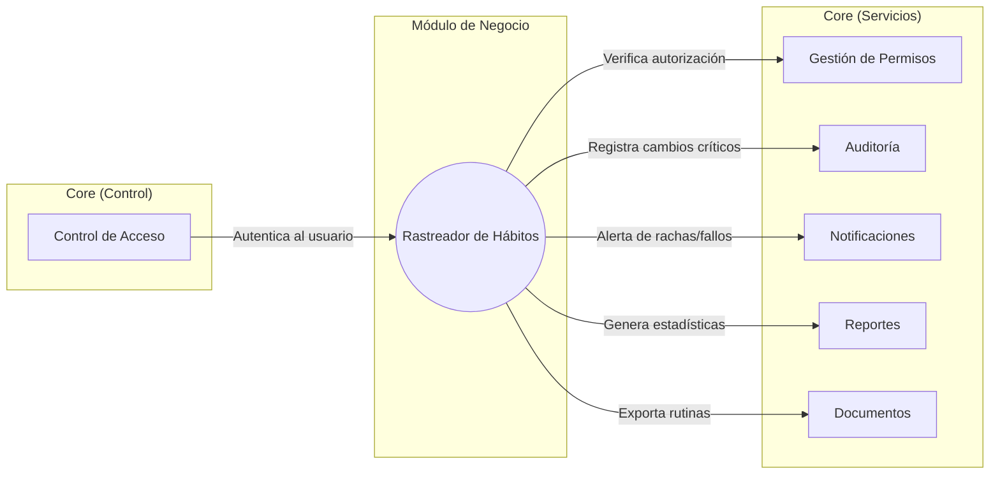

# Rastreador de hábitos con metas

Proyecto de Programación III en C#/.NET 10. La Asignación 2 se ejecuta desde `RastreadorHabitos.Api`, una API HTTP independiente de la plantilla WinForms inicial. Además del control de acceso de la Práctica 1, incorpora Gestión de permisos con solicitudes persistentes, aprobación o rechazo en el servidor y aplicación automática del permiso aprobado. Los usuarios, sesiones, correos y solicitudes se guardan en JSON fuera del proceso.

## Requisitos para ejecutar

- Windows, PowerShell 7 y SDK de .NET 10.
- Un servidor SMTP con STARTTLS, usuario y contrasena. Para un correo personal puede requerirse una contrasena de aplicacion.
- Un correo real al que se tenga acceso para abrir el enlace de activacion y recibir los codigos.

No se necesita SQL Server ni instalar paquetes NuGet adicionales. El archivo de datos se crea al iniciar en `data/rastreador.json` y `data/` esta excluido de Git. Los valores de las variables son privados; no deben guardarse en archivos versionados.

## Obtener la versión evaluada

En PowerShell, clone el repositorio y cambie a la etiqueta que se evalua:

```powershell
git clone https://github.com/osenrey-code/RastreadorHabitos.git
Set-Location .\RastreadorHabitos
git checkout asignacion-2
dotnet --version
```

El SDK debe ser .NET 10. Todos los comandos restantes de este README se ejecutan desde la raiz clonada. Configure las variables de entorno en las terminales indicadas antes de iniciar la API y el procesador de correo.

## Variables de entorno

| Variable | Uso |
| --- | --- |
| `RASTREADOR_DATA_DIR` | Directorio compartido por la API y el comando de envio; por defecto `data/` relativo al directorio de trabajo. |
| `RASTREADOR_BASE_URL` | URL incluida en el enlace de activacion; por defecto `http://localhost:5075`. |
| `RASTREADOR_ADMIN_EMAIL` | Correo del Administrador inicial; se utiliza solo si aun no existe un Administrador. |
| `RASTREADOR_ADMIN_PASSWORD` | Contrasena del Administrador inicial; minimo ocho caracteres con letras y numeros. |
| `RASTREADOR_SMTP_HOST` | Servidor SMTP. |
| `RASTREADOR_SMTP_PORT` | Puerto SMTP con STARTTLS, indicado por el proveedor. |
| `RASTREADOR_SMTP_FROM` | Correo remitente autorizado por el servidor SMTP. |
| `RASTREADOR_SMTP_USER` | Usuario SMTP. |
| `RASTREADOR_SMTP_PASSWORD` | Contrasena SMTP o contrasena de aplicacion. |

Desde la raiz del repositorio, en la **primera terminal**:

```powershell
$env:RASTREADOR_DATA_DIR = Join-Path (Get-Location) 'data'
$env:RASTREADOR_BASE_URL = 'http://localhost:5075'
$env:RASTREADOR_ADMIN_EMAIL = Read-Host 'Correo del administrador'
$env:RASTREADOR_ADMIN_PASSWORD = Read-Host 'Contrasena del administrador' -MaskInput
dotnet run --project .\RastreadorHabitos.Api\RastreadorHabitos.Api.csproj --no-launch-profile --urls http://localhost:5075
```

El Administrador inicial se crea una sola vez. Reiniciar la API no cambia su contrasena ni borra usuarios. La API responde en `http://localhost:5075/`. Si el enlace se abrira desde otro dispositivo, configure `RASTREADOR_BASE_URL` con una direccion accesible desde el.

En la **segunda terminal**, configure el mismo directorio y el servidor de correo. Para Gmail, active la verificacion en dos pasos en su cuenta y cree una [contrasena de aplicacion](https://support.google.com/accounts/answer/185833?hl=es). Use `smtp.gmail.com`, puerto `587`, y el mismo correo de Gmail para remitente y usuario. No use la contrasena normal de la cuenta. La [configuracion SMTP de Gmail](https://support.google.com/mail/answer/7104828?hl=es) requiere STARTTLS en ese puerto:

```powershell
$env:RASTREADOR_DATA_DIR = Join-Path (Get-Location) 'data'
$env:RASTREADOR_SMTP_HOST = 'smtp.gmail.com'
$env:RASTREADOR_SMTP_PORT = '587'
$env:RASTREADOR_SMTP_FROM = Read-Host 'Correo de Gmail remitente'
$env:RASTREADOR_SMTP_USER = $env:RASTREADOR_SMTP_FROM
$env:RASTREADOR_SMTP_PASSWORD = Read-Host 'Contrasena de aplicacion de Gmail' -MaskInput
dotnet run --project .\RastreadorHabitos.Api\RastreadorHabitos.Api.csproj --no-launch-profile -- send-mail
```

Ejecute la ultima linea cada vez que quiera enviar los correos pendientes. La API no contacta SMTP durante el registro ni la recuperacion. Si el servidor no responde, los correos siguen pendientes; corrija la conexion y vuelva a ejecutar el comando. Tras un envio correcto, ejecutarlo otra vez no reenvia el mismo correo.

## Pruebas

Desde un clon limpio, un solo comando restaura las dependencias, compila y ejecuta toda la suite de Gestión de permisos sin levantar la API:

```powershell
dotnet test .\RastreadorHabitos.Pruebas\RastreadorHabitos.Pruebas.csproj
```

La suite contiene diez pruebas MSTest independientes. Cada una separa las fases preparar, actuar y verificar, y cubre creación, entrada inválida, visibilidad, listado pendiente, aprobación con aplicación automática, rechazo con motivo, transiciones prohibidas, autorresolución y persistencia.

## Comandos base de verificación

Los ejemplos se ejecutan en una **tercera terminal** PowerShell 7, con el servidor en marcha. Use un correo propio distinto del Administrador:

```powershell
$base = 'http://localhost:5075'
$correo = Read-Host 'Correo real de prueba'
$clave = 'Clave12345'
function Enviar($ruta, $datos, $metodo = 'Post', $token = '') {
    $cabeceras = @{}
    if ($token) { $cabeceras.Authorization = "Bearer $token" }
    $opciones = @{ Uri = "$base$ruta"; Method = $metodo; Headers = $cabeceras; SkipHttpErrorCheck = $true }
    if ($metodo -ne 'Get') {
        $opciones.ContentType = 'application/json'
        $opciones.Body = $datos | ConvertTo-Json -Compress
    }
    Invoke-WebRequest @opciones
}
```

## Gestión de permisos: RF-GP-01 a 07

Inicie la API con un Administrador configurado y tenga al menos una cuenta Estándar activa. En la tercera terminal, después de definir `$base` y `Enviar`, obtenga ambas sesiones:

```powershell
$correo = Read-Host 'Correo del usuario Estandar activo'
$clave = Read-Host 'Contrasena del usuario Estandar' -MaskInput
$token = ((Enviar '/api/auth/login' @{correo=$correo; contrasena=$clave}).Content | ConvertFrom-Json).token
$correoAdmin = Read-Host 'Correo del Administrador'
$claveAdmin = Read-Host 'Contrasena del Administrador' -MaskInput
$admin = ((Enviar '/api/auth/login' @{correo=$correoAdmin; contrasena=$claveAdmin}).Content | ConvertFrom-Json).token
$usuarios = (Enviar '/api/admin/users' @{} 'Get' $admin).Content | ConvertFrom-Json
$idUsuario = ($usuarios | Where-Object correo -eq $correo).id
```

### RF-GP-01 Crear una solicitud pendiente

```powershell
$solicitud = (Enviar '/api/permisos/solicitudes' @{permiso='habitos.exportar'} 'Post' $token).Content | ConvertFrom-Json
$solicitud
```

La respuesta es `201` y muestra `estado: Pendiente`.

### RF-GP-02 Consultar solicitudes con la visibilidad correcta

```powershell
Enviar '/api/admin/permisos/solicitudes/pendientes' @{} 'Get' $admin
Enviar '/api/permisos/solicitudes' @{} 'Get' $token
$idAjeno = Read-Host 'Id de una solicitud creada por otro usuario Estandar'
Enviar "/api/permisos/solicitudes/$idAjeno" @{} 'Get' $token
```

El Administrador ve las pendientes. El usuario Estándar solo ve las suyas; consultar por identificador una solicitud ajena devuelve `403`.

### RF-GP-03 y RF-GP-05 Aprobar y aplicar automáticamente

```powershell
Enviar "/api/admin/permisos/solicitudes/$($solicitud.id)/aprobar" @{} 'Post' $admin
Enviar '/api/permisos/habitos.exportar/comprobar' @{} 'Get' $token
```

La aprobación devuelve `estado: Aplicada`, `resueltaPor` con el identificador del Administrador y `resuelta` con la fecha. La comprobación devuelve `concedido: true`, sin intervención manual adicional.

### RF-GP-04 Rechazar con motivo escrito

```powershell
$paraRechazar = (Enviar '/api/permisos/solicitudes' @{permiso='habitos.eliminar'} 'Post' $token).Content | ConvertFrom-Json
Enviar "/api/admin/permisos/solicitudes/$($paraRechazar.id)/rechazar" @{motivo='   '} 'Post' $admin
Enviar "/api/permisos/solicitudes/$($paraRechazar.id)" @{} 'Get' $token
Enviar "/api/admin/permisos/solicitudes/$($paraRechazar.id)/rechazar" @{motivo='No corresponde al perfil'} 'Post' $admin
```

El motivo vacío devuelve `400` y la consulta siguiente conserva `Pendiente`. El rechazo válido devuelve `Rechazada` y registra el motivo.

### RF-GP-06 Rechazar transiciones prohibidas

```powershell
Enviar "/api/admin/permisos/solicitudes/$($solicitud.id)/aprobar" @{} 'Post' $admin
Enviar "/api/permisos/solicitudes/$($solicitud.id)" @{} 'Get' $token
Enviar "/api/admin/permisos/solicitudes/$($paraRechazar.id)/aprobar" @{} 'Post' $admin
Enviar "/api/permisos/solicitudes/$($paraRechazar.id)" @{} 'Get' $token
```

Aprobar por segunda vez y aprobar una solicitud rechazada devuelven `409`; los estados permanecen `Aplicada` y `Rechazada`, respectivamente.

### RF-GP-07 Impedir que alguien resuelva su propia solicitud

Primero cree una solicitud pendiente con el usuario Estándar. Luego el Administrador convierte esa misma cuenta en Administrador. El cambio de rol cierra sus sesiones, por lo que debe iniciar sesión otra vez antes de intentar aprobar su propia solicitud:

```powershell
$propia = (Enviar '/api/permisos/solicitudes' @{permiso='habitos.administrar'} 'Post' $token).Content | ConvertFrom-Json
Enviar "/api/admin/users/$idUsuario/role" @{rol='Administrador'} 'Put' $admin
$adminSolicitante = ((Enviar '/api/auth/login' @{correo=$correo; contrasena=$clave}).Content | ConvertFrom-Json).token
Enviar "/api/admin/permisos/solicitudes/$($propia.id)/aprobar" @{} 'Post' $adminSolicitante
```

La última operación devuelve `403` y la solicitud sigue `Pendiente`.

### Persistencia RD-09

Detenga y reinicie la API conservando el mismo `RASTREADOR_DATA_DIR`. Vuelva a iniciar sesión y ejecute `GET /api/permisos/solicitudes`: las solicitudes y los permisos aplicados continúan disponibles.

### Registro y activacion: RF-CA-01, 02, 14 a 17

```powershell
Enviar '/api/auth/register' @{nombre='Evaluador'; correo=$correo; contrasena=$clave}
Enviar '/api/auth/login' @{correo=$correo; contrasena=$clave}
Enviar '/api/auth/register' @{nombre='Duplicado'; correo=$correo; contrasena=$clave}
Enviar '/api/auth/register' @{nombre='Invalido'; correo='correo-invalido'; contrasena=$clave}
Enviar '/api/auth/register' @{nombre='Corta'; correo='otro-correo@example.com'; contrasena='Ab123'}
```

Se esperan respectivamente `201` con `activo:false`, `403` con cuenta inactiva, `409` por correo repetido y dos respuestas `400` controladas. Ejecute `send-mail` en la segunda terminal y abra el enlace recibido. El primer acceso devuelve `200`; abrirlo otra vez devuelve `400`. Antes de abrirlo puede solicitar otro enlace:

```powershell
Enviar '/api/auth/resend-activation' @{correo=$correo}
Enviar '/api/auth/resend-activation' @{correo='ausente@example.com'}
```

Las dos respuestas son iguales; el enlace anterior deja de servir. Para inspeccionar el hash con sal, registre un segundo usuario con otra direccion real y la misma clave:

```powershell
$correoHash = Read-Host 'Otro correo real para comparar hashes'
Enviar '/api/auth/register' @{nombre='Comparacion'; correo=$correoHash; contrasena=$clave}
```

Ejecute `send-mail` en la segunda terminal, active esa cuenta desde su correo y compare ambos valores `HashContrasena` en `data/rastreador.json`: deben ser distintos y no contener la clave. El archivo nunca debe subirse al repositorio.

### Sesion y bloqueo: RF-CA-03, 07, 18, 19

Despues de activar la cuenta:

```powershell
$login = (Enviar '/api/auth/login' @{correo=$correo; contrasena=$clave}).Content | ConvertFrom-Json
$token = $login.token
Enviar '/api/me/' @{} 'Get' $token
Enviar '/api/auth/login' @{correo='ausente@example.com'; contrasena='Incorrecta1'}
Enviar '/api/auth/login' @{correo=$correo; contrasena='Incorrecta1'}
Enviar '/api/me/logout' @{} 'Post' $token
Enviar '/api/me/' @{} 'Get' $token
```

La consulta autenticada devuelve el usuario y rol; ambos inicios fallidos devuelven el mismo mensaje `401`; tras cerrar sesion, la credencial devuelve `401`. En esta secuencia ya se hizo un intento fallido para demostrar el mensaje generico. Haga cuatro intentos fallidos adicionales (intentos 2 a 5) y luego pruebe la clave correcta como sexto intento:

```powershell
1..4 | ForEach-Object { (Enviar '/api/auth/login' @{correo=$correo; contrasena='Incorrecta1'}).StatusCode }
(Enviar '/api/auth/login' @{correo=$correo; contrasena=$clave}).StatusCode
```

Los cuatro intentos adicionales devuelven `401` y el sexto (aunque use la clave correcta) devuelve `429` durante 15 minutos. Use otra cuenta o espere ese tiempo para continuar.

### Roles y administracion: RF-CA-04 a 06, 08, 20, 21

Vuelva a iniciar sesion con un usuario Estándar y construya a mano una peticion de Administrador:

```powershell
$token = ((Enviar '/api/auth/login' @{correo=$correo; contrasena=$clave}).Content | ConvertFrom-Json).token
Enviar '/api/admin/users' @{} 'Get' $token
Enviar '/api/admin/users/00000000-0000-0000-0000-000000000001/role' @{rol='Administrador'} 'Put' $token
```

Ambas devuelven `403`, incluso si se intenta cambiar el propio rol. Los grupos protegidos y sus roles se leen en `RastreadorHabitos.Api/Program.cs`, mediante `RequireRol`. En esta tercera terminal indique de nuevo los datos del Administrador, pues las variables de la primera terminal no se comparten:

```powershell
$correoAdmin = Read-Host 'Correo del administrador'
$claveAdmin = Read-Host 'Contrasena del administrador' -MaskInput
$admin = ((Enviar '/api/auth/login' @{correo=$correoAdmin; contrasena=$claveAdmin}).Content | ConvertFrom-Json).token
$usuarios = (Enviar '/api/admin/users' @{} 'Get' $admin).Content | ConvertFrom-Json
$usuarios
$id = ($usuarios | Where-Object correo -eq $correo).id
Enviar "/api/admin/users/$id/role" @{rol='Administrador'} 'Put' $admin
Enviar "/api/admin/users/$id/deactivate" @{} 'Put' $admin
Enviar '/api/me/' @{} 'Get' $token
Enviar "/api/admin/users/$id/reactivate" @{} 'Put' $admin
$idAdmin = ($usuarios | Where-Object correo -eq $correoAdmin).id
Enviar "/api/admin/users/$idAdmin/deactivate" @{} 'Put' $admin
```

El listado nunca contiene hashes ni tokens; cambiar rol y desactivar requieren Administrador. La sesion del usuario desactivado devuelve `401`. El intento de autodesactivacion devuelve `400`.

### Recuperacion y cambio de contrasena: RF-CA-09 a 13, 22

```powershell
Enviar '/api/auth/request-reset' @{correo='ausente@example.com'}
Enviar '/api/auth/request-reset' @{correo=$correo}
```

Las respuestas son identicas. Ejecute `send-mail`, copie el codigo recibido y siga:

```powershell
$codigo = Read-Host 'Codigo recibido'
$anterior = ((Enviar '/api/auth/login' @{correo=$correo; contrasena=$clave}).Content | ConvertFrom-Json).token
Enviar '/api/auth/reset-password' @{correo=$correo; codigo=$codigo; contrasenaNueva='Nueva12345'}
Enviar '/api/auth/reset-password' @{correo=$correo; codigo=$codigo; contrasenaNueva='Otra12345'}
Enviar '/api/me/' @{} 'Get' $anterior
Enviar '/api/auth/login' @{correo=$correo; contrasena=$clave}
$nuevaSesion = ((Enviar '/api/auth/login' @{correo=$correo; contrasena='Nueva12345'}).Content | ConvertFrom-Json).token
Enviar '/api/me/change-password' @{contrasenaActual='Incorrecta1'; contrasenaNueva='Tercera123'} 'Post' $nuevaSesion
Enviar '/api/me/change-password' @{contrasenaActual='Nueva12345'; contrasenaNueva='Tercera123'} 'Post' $nuevaSesion
Enviar '/api/me/' @{} 'Get' $nuevaSesion
```

El codigo repetido devuelve `400`; la sesion anterior devuelve `401`; la contrasena vieja no permite iniciar sesion; una contrasena actual incorrecta devuelve `400`; el cambio correcto invalida la sesion. Para el restablecimiento forzado, use el token de Administrador y el identificador obtenido en el listado:

```powershell
Enviar "/api/admin/users/$id/force-reset" @{} 'Post' $admin
```

Ejecute `send-mail`, copie el nuevo codigo del correo y utilice `/api/auth/reset-password` con ese codigo. La contrasena anterior deja de servir inmediatamente.

El codigo de recuperacion vence a los 30 minutos. La comprobacion automatizada demuestra el rechazo sin esperar ese tiempo real: usa un reloj controlado, avanza 31 minutos e intenta reutilizar el codigo vencido. Ejecute el verificador al final de este README para repetirla. Para comprobarlo manualmente contra la API, solicite otro codigo, espere mas de 30 minutos y envie `/api/auth/reset-password`; debe responder `400`.

### Cola y persistencia: RF-NOT-08, 09, 12, 13; RD-09 y RD-10

Detenga el acceso al servidor SMTP y registre otro usuario: el registro devuelve `201` y el correo queda con `Estado: Pendiente` en `data/rastreador.json`. Vuelva a habilitar SMTP y ejecute `send-mail` dos veces; el segundo comando indica `Enviados: 0`. Reinicie la API con el mismo `RASTREADOR_DATA_DIR`: los usuarios siguen presentes.

El envio real requiere credenciales SMTP. No se pueden verificar correos entregados sin un servidor configurado. Las pruebas locales de logica, incluidas la expiracion del enlace de activacion, el sexto intento de inicio de sesion y la expiracion del codigo de recuperacion, se ejecutan con:

```powershell
dotnet run --project .\RastreadorHabitos.Verificacion\RastreadorHabitos.Verificacion.csproj
```

## Maquina de estados y entrega

La entidad `Meta` tiene `EstadoMeta` con cuatro estados. Las transiciones permitidas, la prohibida explicita y los estados terminales se declaran en `RastreadorHabitos.Api/EstadoMeta.cs`; la tabla exigida esta en `docs/maquina-de-estados.md`. Las operaciones completas del rastreador se entregan despues.

La Asignación 2 se entrega con un tag `asignacion-2` sobre el punto integrado. El tag se envía con `git push origin --tags`; en Moodle se entrega la URL del repositorio y el nombre de la etiqueta. No coloque contraseñas ni `data/` en Git.

## Diagrama de componentes existente


